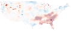
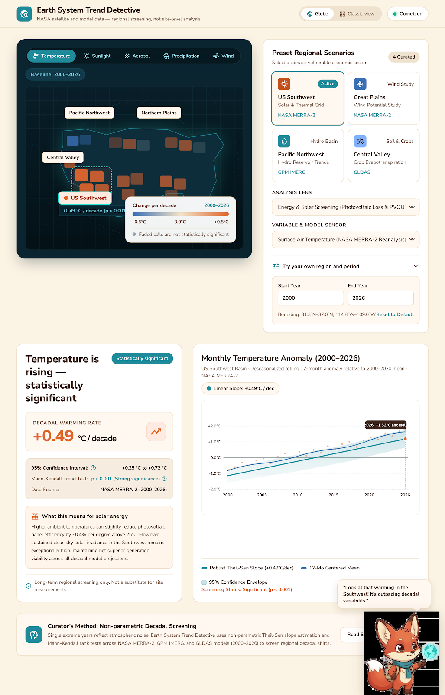
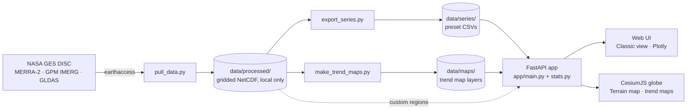

<div align="center">

# 🌎 Earth System Trend Detective

**See what is changing in NASA Earth data, where, by how much, and whether the change is statistically real.**

NASA Space Apps Challenge 2026

[](https://www.python.org/)
[](https://fastapi.tiangolo.com/)
[](https://cesium.com/platform/cesiumjs/)
[](https://plotly.com/javascript/)
[](https://www.earthdata.nasa.gov/)
[](https://vercel.com/)
[](LICENSE)

**[▶ Live demo]([YOUR VERCEL URL])** · [Quick start](#-quick-start) · [How the statistics work](#-statistics-explained-simply)

</div>

---

## 📸 Screenshots

<!-- TODO: add real screenshots of the running app to docs/img/ and reference them here:
     1. docs/img/globe.png          – Globe view with the four demo regions and a trend map draped over the US
     2. docs/img/terrain-map.png    – Terrain map mode (flat, tilted US relief with contours)
     3. docs/img/classic-view.png   – Classic view with a trend chart and the result card
     4. docs/img/comet-tutorial.png – Comet the fox walking through the first-visit tutorial -->

| Per-cell trend maps (real output from `make_trend_maps.py`) | |
|:---:|:---:|
| <br>**Air temperature (2 m), 2000-01 to 2026-09**<br>72% of cells significant after FDR correction | <br>**Precipitation, 2000-01 to 2025-09**<br>0.8% of cells significant after FDR correction |

<details>
<summary><b>UI design concept</b> (Google Stitch mock-up, not a screenshot of the running app)</summary>
<br>
<p align="center"></p>
<sub>Design exploration used as a visual reference for the page's look (<code>design/stitch/</code>). Some text in the mock-up is placeholder copy and does not come from the app.</sub>
</details>

---

## Contents

- [What it does](#-what-it-does)
- [Features](#-features)
- [Data sources](#-data-sources)
- [Statistics, explained simply](#-statistics-explained-simply)
- [Quick start](#-quick-start)
- [Architecture](#-architecture)
- [Testing](#-testing)
- [Limitations and honest notes](#-limitations-and-honest-notes)
- [Credits and licences](#-credits-and-licences)
- [AI-assistance disclosure](#-ai-assistance-disclosure)
- [Team and links](#-team-and-links)

---

## 🔎 What it does

Pick an Earth-science variable (temperature, rain, sunlight, soil moisture, wind, snow, haze…), a region and a time period. The app averages about 26 years of monthly NASA satellite and model data over that region, removes the yearly seasonal cycle, and tells you how fast the remaining long-term change is and whether it is bigger than natural month-to-month wobble could produce by chance. Optional **lenses** then translate the result into plain language for solar, wind, hydropower and farming.

**Why it matters:** decisions about energy, water and agriculture increasingly depend on how regional conditions are shifting, but raw NASA datasets are large and hard to interpret. This tool turns them into an honest, tested answer — including saying "we can't tell yet" when the data are too noisy. It is a **screening** tool: it points to regions and variables worth a closer look; it does not explain causes.

---

## ✨ Features

| | Feature | What you get |
|---|---|---|
| 📈 | **Trend statistics** | Sen's slope per decade, 95% range, autocorrelation-corrected Mann-Kendall p-value and a plain-language verdict |
| 🔭 | **Lenses** | Solar, Wind, Hydro and Farming (`lenses.yml`): filter the variables and add a fixed-template sentence plus a caveat. No AI, no yield or financial models |
| 🗺️ | **US trend heatmaps** | Per-grid-cell trend maps for 7 variables, with Benjamini-Hochberg FDR at 10%; significant cells solid, the rest faded; hover a cell for its value |
| 🌍 | **3D globe** | CesiumJS globe with the four demo regions as clickable boxes, top-down view, optional terrain and height exaggeration (with a Cesium ion token) |
| ⛰️ | **Terrain map mode** | A flat, tilted terrain map of the US with its own height slider and a contours switch |
| 🦊 | **Comet the fox** | An optional, draggable guide with a first-visit tutorial, a replay button and "?" buttons that explain terms |
| 📋 | **Classic view** | Scenario cards, region/period form, Plotly chart and result card; also the automatic fallback if WebGL is unavailable |

**Four demo regions** (`presets.yml`), each with a recommended lens:

| Preset | Box (W, S, E, N) | Lens |
|---|---|---|
| US Southwest (Arizona and southern Nevada) | -117.0, 31.3, -109.0, 38.0 | Solar |
| Great Plains (Texas to Iowa) | -103.0, 30.0, -91.0, 43.5 | Wind |
| Pacific Northwest (US Columbia basin) | -124.0, 42.0, -111.0, 49.0 | Hydro |
| California Central Valley | -122.6, 35.0, -118.8, 40.6 | Farming |

---

## 🛰️ Data sources

All data are monthly, from NASA GES DISC via [NASA Earthdata](https://www.earthdata.nasa.gov/). The running app never calls NASA; it reads pre-processed files.

<details open>
<summary><b>Variables, datasets and caveats</b></summary>
<br>

| Variable | NASA dataset | Period in the app | Caveats |
|---|---|---|---|
| Air temperature (2 m) | MERRA-2 `M2TMNXSLV` | 2000-01 – 2026-09 | Reanalysis: model + observations, not station truth |
| Wind speed (50 m) | MERRA-2 `M2TMNXSLV` | 2000-01 – 2026-09 | ⚠️ Speed of the **monthly-mean wind vector**, which underestimates real wind (presets show ~2–3 m/s). Relative change only; never for sizing turbines |
| Sunlight reaching the ground, cloud cover | MERRA-2 `M2TMNXRAD` | 2000-01 – 2026-09 | Reanalysis |
| Aerosol optical depth | MERRA-2 `M2TMNXAER` | 2000-01 – 2026-09 | Reanalysis |
| Precipitation | GPM IMERG v07 `GPM_3IMERGM` | 2000-01 – 2025-09 | Final product lags ~1 year; stored coarsened from 0.1° to 0.5° |
| Soil moisture (top 10 cm), evaporation | GLDAS Noah 2.1 `GLDAS_NOAH025_M` | 2000-01 – 2026-07 | ⚠️ **Experimental**: maps show model-input artefacts and some series have abrupt level shifts; no irrigation in the model. Treat as indicative |
| Surface runoff | GLDAS Noah 2.1 | 2000-01 – 2026-07 | Runoff is a water-availability proxy, not river flow |
| Snow water equivalent, snow depth, snowfall | GLDAS Noah 2.1 | 2000-01 – 2026-07 | ⚠️ **Reliability flag**: results are marked low-reliability when there is too little snow even at the seasonal peak or more than 50% of months are tied (e.g. zero) |

Periods come from `data/series/index.yml`; each variable's real period is shown in the app, so different variables cover slightly different years.
</details>

---

## 📐 Statistics, explained simply

The code is in [`stats.py`](stats.py); the per-cell maps use the same tests in [`make_trend_maps.py`](make_trend_maps.py).

| Step | What it does | In plain words |
|---|---|---|
| **Seasonal removal** | Subtracts each calendar month's average (on by default) | Summer is always hotter than winter; we only want the change *across years* |
| **Sen's slope** (per decade) | Median of the slopes between every pair of months | A trend line that one freak month can't drag around |
| **Mann-Kendall test** | Asks how often random wobble alone would give a trend this consistent → the **p-value** | Below 0.05 (1 in 20) we call it "significant" |
| **Hamed-Rao correction** | Widens the uncertainty for month-to-month persistence (first 4 lags) | A dry spell lasts several months, so 300 months are fewer than 300 independent clues |
| **95% range** | The span of slopes that fit the data reasonably well, adjusted the same way | How sure we are about the size of the change |
| **Benjamini-Hochberg FDR at 10%** (maps only) | Corrects for testing thousands of grid cells at once | Among cells marked significant, at most ~1 in 10 is expected to be a false alarm |

> [!IMPORTANT]
> **"Not significant" does not mean "no change."** It means the record is too short or too noisy to tell yet. A significant result says the change is unlikely to be chance; it does not say what caused it.

**Worked example** (committed data, US Southwest preset, returned by `GET /trend`):

| | Air temperature (2 m) | Precipitation |
|---|---|---|
| Record | 321 months (2000-01 – 2026-09) | 309 months (2000-01 – 2025-09) |
| Sen's slope | **+0.49 °C per decade** | +0.56 mm/month per decade (+2.6%) |
| 95% range (corrected) | +0.26 to +0.73 | −1.72 to +2.75 |
| p-value | 0.00004 | 0.62 |
| Verdict | ✅ **Significant** | ⏳ **Not significant yet** — the range includes zero |

<details>
<summary><b>How well does the correction work?</b> (simulation results)</summary>
<br>

On 200 computer-generated series with month-to-month memory but **no** trend:

| | Basic test | Corrected (what the app uses) |
|---|---|---|
| False alarms (target 5%) | 31% | 7% |
| 95% range contains the true slope (target 95%) | 69% | 93% |

With a real trend added, the corrected test still detected it 82% of the time. `method=plain` in the API selects the basic test.
</details>

---

## 🚀 Quick start

**Requirements:** Python 3.12 and Git. No NASA account or big downloads are needed for the demo.

```bash
git clone https://github.com/Ismail-deb/Nasa-App-challenge.git
cd Nasa-App-challenge
python -m venv venv
venv\Scripts\activate            # macOS/Linux: source venv/bin/activate
pip install -r requirements.txt
uvicorn app.main:app --port 8000
```

Open **http://127.0.0.1:8000**. `GET /health` returns `{"status": "ok", ...}`.

### Cesium ion token (optional)

Without a token the globe runs offline (no terrain). Never commit a token.

- **Locally:** copy `frontend/config.local.example.js` to `frontend/config.local.js` (git-ignored) and put your token there.
- **On Vercel:** set the environment variable `CESIUM_ION_TOKEN` in the project settings; the server serves it through `/frontend/config.local.js` without writing it to disk. A browser-side token is visible to visitors, so **restrict it to your site's URL** in the Cesium ion dashboard and keep its scopes minimal.

### What works with which data

| Feature | Committed small data (`data/series/`, `data/maps/`) | Full gridded data (`data/processed/`, multi-GB, not in git) |
|---|:---:|:---:|
| Four demo regions, all lenses, charts | ✅ | ✅ |
| Globe, Terrain map, trend heatmaps | ✅ | ✅ |
| Hosted demo on Vercel | ✅ | — |
| Custom regions (typed W/S/E/N box) | ❌ "Custom regions need the full dataset" | ✅ |

<details>
<summary><b>Optional dependency sets and data pipeline</b></summary>
<br>

| File | Purpose |
|---|---|
| `requirements.txt` | Runtime only (what Vercel installs) |
| `requirements-dev.txt` | Test suite + data pipeline + pytest |
| `requirements-data.txt` | Downloading NASA data and custom regions |
| `requirements-maps.txt` | Regenerating the trend maps only |

To download NASA data you need a free [Earthdata login](https://urs.earthdata.nasa.gov), provided via the `EARTHDATA_USERNAME` / `EARTHDATA_PASSWORD` environment variables or a `~/.netrc` file (both kept out of git).

```bash
python check_catalog.py                 # verify catalog.yml against NASA
python pull_data.py atmosphere_solar    # also: weather_climate, hydrology, cryosphere
python export_series.py                 # rebuild data/series/ for the presets
python make_trend_maps.py --help        # rebuild data/maps/ (needs requirements-maps.txt)
python fetch_data.py                    # fetch processed files from the GitHub Release instead
```
</details>

---

## 🏗️ Architecture



<details>
<summary><b>Project structure</b></summary>

```text
Nasa-App-challenge/
├── app/                  FastAPI app: main.py (API), data.py, display.py, lenses.py, presets.py
├── stats.py              Sen's slope, Mann-Kendall (Hamed-Rao), seasonal removal, snow reliability
├── catalog.yml           Variables, grouped by category, with plain-language descriptions
├── lenses.yml            Solar / Wind / Hydro / Farming templates
├── presets.yml           The four demo regions
├── pull_data.py          Download + compact NASA granules → data/processed/
├── export_series.py      Preset regional means → data/series/
├── make_trend_maps.py    Per-cell trend maps (FDR 10%) → data/maps/
├── fetch_data.py         Fetch processed data from a GitHub Release
├── check_catalog.py      Check catalog.yml against NASA CMR
├── data/
│   ├── series/           Committed preset series (small CSVs + index.yml)
│   └── maps/             Committed trend map layers + index.yml
├── web/                  index.html, fonts, globe/, guide/ (Comet), vendored Plotly
├── frontend/             config.local.example.js, vendored CesiumJS
├── design/stitch/        Design reference (not used at runtime)
├── tests/                pytest suite (+ opt-in browser tests)
├── vercel.json           Vercel function bundle exclusions
└── pyproject.toml        Project metadata, Vercel entrypoint app.main:app
```
</details>

---

## 🧪 Testing

```bash
pip install -r requirements-dev.txt
pytest -q
```

Latest local run (`pytest -q`, 2026-11-15): **380 passed, 15 skipped** in about 3 minutes (most of it the statistical simulations in `tests/test_stats.py`).

All tests run offline and are deterministic (fixed seeds). Trend-map generator tests skip unless `requirements-maps.txt` is installed.

**Browser tests (opt-in):** `tests/test_page_browser.py` clicks through the real page in headless Edge, Chrome or Chromium. They are slow and timing-sensitive, so they run only when `RUN_BROWSER_TESTS=1` is set **and** a supported browser is found (`BROWSER_BIN` can point to one).

```bash
RUN_BROWSER_TESTS=1 pytest -q tests/test_page_browser.py                # macOS/Linux
$env:RUN_BROWSER_TESTS = "1"; pytest -q tests/test_page_browser.py      # PowerShell
```

---

## ⚠️ Limitations and honest notes

- **Regional screening, not site measurement.** Every value is an average over a large region. Not site feasibility, irrigation scheduling, or financial advice.
- **Custom regions need local data.** A fresh clone and the hosted site answer the four demo regions only; typed boxes need the multi-GB `data/processed/` files.
- **Trends are not attributed to causes.** A straight line cannot describe a change that speeds up, reverses or steps, and slow cycles such as El Niño can look like a trend in a ~26-year record.
- **Experimental GLDAS layers.** Soil moisture and evaporation can show model-input artefacts and level shifts (e.g. Pacific Northwest evaporation around 2003).
- **Wind underestimates real speeds** (monthly-mean vectors) — relative change only.
- **The corrected test is slightly generous** (~7% false alarms instead of 5% in simulation).
- **IMERG coarsening** to 0.5° affects regional means by 0.1–6% for the region sizes this app is designed for, more for boxes of ~1° or smaller.
- MERRA-2 and GLDAS are model output that assimilates or is driven by observations: indicative, not station truth.

---

## 🙏 Credits and licences

| Component | Credit / licence |
|---|---|
| MERRA-2 | NASA GMAO, distributed by NASA GES DISC |
| GPM IMERG v07 | NASA GPM mission, distributed by NASA GES DISC |
| GLDAS Noah 2.1 | NASA GLDAS, distributed by NASA GES DISC |
| Data access & learning | [`earthaccess`](https://github.com/nsidc/earthaccess); [NASA GES DISC tutorials](https://github.com/nasa/gesdisc-tutorials) (reference only) |
| CesiumJS | Apache 2.0, vendored in `frontend/vendor/cesium/`; optional terrain and imagery from **Cesium ion** |
| Natural Earth | Public domain; country boundaries for the US mask and outline |
| Nunito Sans | SIL Open Font License 1.1 (`web/fonts/OFL.txt`) |
| Plotly.js 2.35.2 | MIT, vendored in `web/vendor/plotly/` with its licence |

This project's code is released under the [MIT License](LICENSE).

---

## 🤖 AI-assistance disclosure

- **Claude Code** (Anthropic) — coding assistance.
- **Google Stitch** — UI design exploration (`design/stitch/`).
- **Google Gemini** — the artwork of Comet the fox.

All numbers and results shown by the app come from NASA data processed by this project's own statistical code; the lens sentences are fixed templates, not AI-generated at runtime.

---

## 👥 Team and links

| | |
|---|---|
| **Team** | Ismail Abrahams ([@Ismail-deb](https://github.com/Ismail-deb)) · [@AbraarSayed][][][] |
| **Live demo** | (https://nasa-app-challenge-lilac.vercel.app) |
| **Repository** | https://github.com/Ismail-deb/Nasa-App-challenge |
| **Challenge** | NASA Space Apps Challenge 2026 · *[ADD CHALLENGE PAGE URL]* |

<p align="center"><br><sub>Comet says: check the p-value before you celebrate. 🦊</sub></p>
